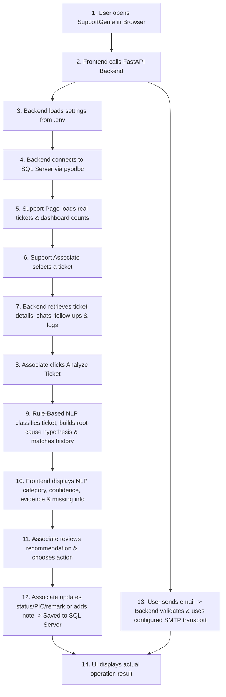

# SupportGenie — Email and AI-Assisted Support Ticket Management System

SupportGenie is a lightweight, local web application built with **Python (FastAPI)**, **pyodbc**, **Microsoft SQL Server (`JotDeskBuddy_Test`)**, **HTML5**, **CSS3**, and **vanilla JavaScript**.

It provides two integrated modules:
1. **Support Console (`/support`)** — Allows support associates to view real dashboard metrics, filter and inspect support tickets from SQL Server, run rule-based NLP classification and root-cause analysis, review historical ticket matches, and persist internal follow-up notes, chat replies, status updates, and resolution remarks.
2. **Email Console (`/email`)** — Provides a clean, Gmail-inspired interface to inspect ticket-linked email records (`dbo.TicketEmailMessages` joined with `dbo.Tickets`), view email-originated tickets, and compose/send support emails via SMTP (with transparent reporting when SMTP is unconfigured).

## 1. Database Schema Summary (`JotDeskBuddy_Test`)

SupportGenie connects directly to the existing **`JotDeskBuddy_Test`** database (`dbo` schema) without altering tables or inserting synthetic runtime data.

### Core Domain & Reference Tables

| Table Name | Primary Key | Foreign Keys | Purpose & Key Columns |
| :--- | :--- | :--- | :--- |
| `dbo.Clients` | `Id` (`BIGINT IDENTITY`) | None | Customer organizations (`ClientName`, `Email`, `ClientShortCode`, `TenantId`, `LogoFileContent`). Seeded with 3 clients (`Northwind Marine Demo`, `Blue Harbor Systems Demo`, `Contoso Vessel Services Demo`). |
| `dbo.Projects` | `Id` (`BIGINT IDENTITY`) | None | Product lines (`Name`, `TenantId`). Seeded with `Jot ERP`, `Integration Services`, `Fleet Operations`. |
| `dbo.Modules` | `Id` (`BIGINT IDENTITY`) | `ProjectId` -> `dbo.Projects(Id)` | Application modules (`Name`, `ProjectName`, `ProjectId`, `TenantId`). Seeded with 6 modules (`Procurement Index`, `Purchase Orders`, `User Administration`, `External API Integration`, `Inventory`, `Vessel Reports`). |
| `dbo.Pic` | `Id` (`BIGINT IDENTITY`) | None | Assignable support associates / Persons In Charge (`Name`, `Email`, `TenantId`). Seeded with `Demo L1 Associate` (1), `Demo L2 Associate` (2), `Demo Product Owner` (3). |
| `dbo.ReportMethods` | `Id` (`BIGINT IDENTITY`) | None | Reporting channels (`MethodName`: `Email`, `Portal`, `Phone`). |
| `dbo.ServiceLevelAgreements` | `Id` (`BIGINT IDENTITY`) | `ClientId` -> `dbo.Clients(Id)` | Client & ticket-type SLA targets (`ClientId`, `ClientName`, `Hours`, `ExcludeSundays`, `ExcludePublicHolidays`, `TicketType`). |
| `dbo.Tickets` | `Id` (`BIGINT IDENTITY`) | `ClientId` -> `dbo.Clients(Id)`, `TicketModule` -> `dbo.Modules(Id)`, `PICId` -> `dbo.Pic(Id)`, `ProjectId` -> `dbo.Projects(Id)`, `ReportedMethodId` -> `dbo.ReportMethods(Id)` | Central ticket table (`Subject`, `Description`, `TicketType`, `TicketTypeName`, `TicketUrgency`, `TicketUrgencyName`, `TicketStatus`, `TicketStatusName`, `ClientName`, `PIC`, `TicketModuleName`, `ProjectName`, `Remark`, `ClosedOn`, `ClosedBy`, `HoursSpentToClose`, `IsClosedWithinSLA`, `FromEmail`, `CCEmails`, `ReportDate`, `IsDraft`, `IsEmailImportCompleted`, `SourceMessageId`, `AddedOnDate`, `EditedOnDate`). |
| `dbo.TicketChat` | `Id` (`BIGINT IDENTITY`) | `TicketId` -> `dbo.Tickets(Id)` | Reporter and support associate conversation thread (`TicketId`, `ChatRunningNumber`, `Chat`, `AddedBy`, `AddedByName`, `AddedOnDate`). |
| `dbo.TicketChatAttachments` | `Id` (`BIGINT IDENTITY`) | `ChatId` -> `dbo.TicketChat(Id)` | File attachment metadata for chat entries (`AttachmentName`, `AttachmentSize`, `AttachmentPath`). |
| `dbo.TicketFollowups` | `Id` (`BIGINT IDENTITY`) | `TicketId` -> `dbo.Tickets(Id)` | Internal investigation notes and follow-up remarks (`TicketId`, `FollowupRunningNumber`, `Remarks`, `AddedBy`, `AddedByName`, `AddedOnDate`). |
| `dbo.FollowupAttachments` | `Id` (`BIGINT IDENTITY`) | `FollowupId` -> `dbo.TicketFollowups(Id)` | File attachment metadata for internal follow-ups (`AttachmentName`, `AttachmentSize`, `AttachmentPath`). |
| `dbo.TicketEmailMessages` | `Id` (`BIGINT IDENTITY`) | `TicketId` -> `dbo.Tickets(Id)` | Ticket-linked email tracking records (`TicketId`, `MessageId`, `IsOutgoing`, `AddedBy`, `AddedByName`, `AddedOnDate`). |
| `dbo.TicketFollowers` | `Id` (`BIGINT IDENTITY`) | `TicketId` -> `dbo.Tickets(Id)` | Users subscribed to ticket updates (`TicketId`, `UserId`, `UserName`). |
| `dbo.UpdateLogs` | `Id` (`BIGINT IDENTITY`) | Logical PK ref (`EntityName`, `PrimaryKey`) | Audit trail of entity updates (`EntityName`, `PrimaryKey`, `Data` JSON payload, `UpdatedOnDate`, `UpdatedBy`, `UpdatedByName`). |
| `dbo.DeleteLogs` | `Id` (`BIGINT IDENTITY`) | Logical PK ref (`EntityName`, `PrimaryKey`) | Audit trail of deleted entities (`EntityName`, `PrimaryKey`, `Data`, `DeletedOnDate`, `DeletedByName`). |

## 2. Mapping of UI Features to Database Tables

| UI Module & Feature | Database Tables & Columns Used | Operation Type |
| :--- | :--- | :--- |
| **Support Dashboard Counts** | `dbo.Tickets` (`IsDraft = 0`, `TicketStatusName`, `TicketUrgencyName`, `PICId`, `PIC`) | **READ** (`SELECT`) |
| **Filter Dropdowns & Associate Selector** | `dbo.Pic`, `dbo.Clients`, `dbo.Modules`, `dbo.Tickets` | **READ** (`SELECT`) |
| **Ticket Queue & Search** | `dbo.Tickets` + subqueries on `dbo.TicketChat` and `dbo.TicketFollowups` | **READ** (`SELECT`) |
| **Ticket Details View** | `dbo.Tickets` joined with `dbo.Clients`, `dbo.Pic`, `dbo.ServiceLevelAgreements`, `dbo.TicketFollowers` | **READ** (`SELECT`) |
| **Ticket History Tabs** | `dbo.TicketFollowups`, `dbo.FollowupAttachments`, `dbo.TicketChat`, `dbo.TicketChatAttachments`, `dbo.TicketEmailMessages`, `dbo.UpdateLogs` | **READ** (`SELECT`) |
| **Rule-Based NLP Ticket Analysis** | `dbo.Tickets`, `dbo.TicketFollowups`, `dbo.TicketChat` | **READ** (`SELECT`) |
| **Add Internal Follow-up Note** | `dbo.TicketFollowups` (`INSERT`) + `dbo.Tickets` (`UPDATE EditedOnDate`) | **WRITE** (`INSERT` / `UPDATE`) |
| **Add Ticket Chat Message** | `dbo.TicketChat` (`INSERT`) + `dbo.Tickets` (`UPDATE EditedOnDate`) | **WRITE** (`INSERT` / `UPDATE`) |
| **Update Status / Assign PIC / Record Resolution** | `dbo.Tickets` (`UPDATE`) + `dbo.UpdateLogs` (`INSERT` JSON audit record) | **WRITE** (`UPDATE` / `INSERT`) |
| **Email Inbox / Sent / All Ticket Emails** | `dbo.TicketEmailMessages` joined with `dbo.Tickets` and `dbo.Clients` | **READ** (`SELECT`) |
| **Send Support Email (linked to Ticket ID)** | `dbo.TicketEmailMessages` (`INSERT` outbound `MessageId` with `IsOutgoing = 1` after SMTP send succeeds) | **WRITE** (`INSERT`) |

## 3. Unsupported Requirements & Schema Limitations

1. **Standalone Email Body, Recipient (`To`/`BCC`), and Email Draft Storage in SQL Server**:
   - `dbo.TicketEmailMessages` only stores `TicketId` (`NOT NULL` FK to `dbo.Tickets`), `MessageId`, `IsOutgoing`, `TenantId`, `AddedBy`, `AddedByName`, and `AddedOnDate`. It does not have columns for email `Subject`, `Body`, `To`, `CC`, `BCC`, or `IsDraft`.
   - SupportGenie joins `dbo.TicketEmailMessages` with `dbo.Tickets` and `dbo.Clients` to display full ticket context, logs outbound `MessageId` records when linked to a valid `TicketId`, and saves Compose drafts in browser `localStorage` with an explicit notice.
2. **User Authentication & Session Table**:
   - There is no `dbo.Users` credentials table; assignable support associates live in `dbo.Pic`. SupportGenie provides an active associate selector in the top bar populated from `dbo.Pic`.

## 4. Application Workflow



## 5. Setup and Running Instructions (VS Code on Windows)

1. **Create and Activate Virtual Environment**:
   ```powershell
   python -m venv .venv
   .\.venv\Scripts\Activate.ps1
   ```
2. **Install Dependencies**:
   ```powershell
   pip install -r requirements.txt
   ```
3. **Configure `.env`**:
   ```powershell
   Copy-Item .env.example .env
   ```
   Set `DB_SERVER`, `DB_NAME=JotDeskBuddy_Test`, `DB_DRIVER=ODBC Driver 18 for SQL Server`, and `DB_AUTH_MODE=windows` (or `sql` with `DB_USER` and `DB_PASSWORD`).
4. **Test Database Connection**:
   ```powershell
   python -c "from supportgenie.database import db_manager; print(db_manager.check_connectivity())"
   ```
5. **Start the Application**:
   ```powershell
   python run.py
   ```
   Open `http://127.0.0.1:8000/support`, `http://127.0.0.1:8000/email`, or `http://127.0.0.1:8000/docs`.
6. **Run Tests**:
   ```powershell
   pytest -v
   ```
